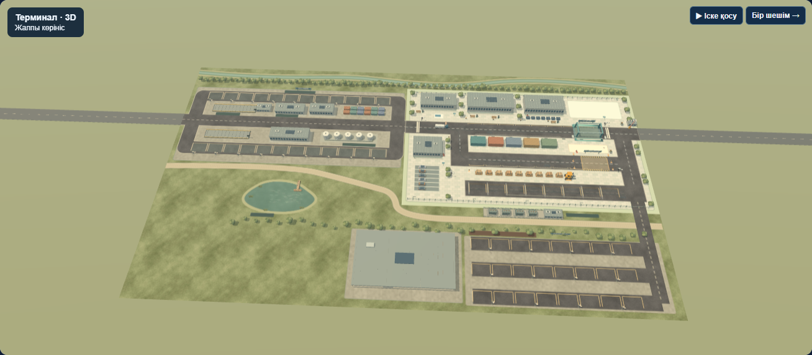
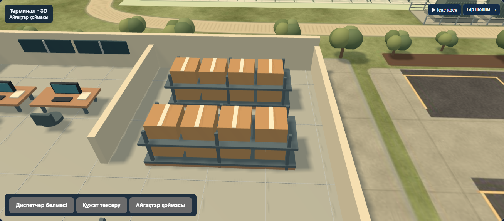

# Smart Customs AI

Smart Customs AI — жүк көліктерін кеден бекетінде тексеруді модельдейтін қазақ тіліндегі оқу жобасы. Агент әр көлік үшін үш әрекеттің бірін таңдайды: өткізу, қосымша сканерге жіберу немесе толық тексеру. Мақсат — шектеулі бекеттерді пайдаланып, бұзушылықтарды анықтау және кезекте күту уақытын азайту.



## Іске қосу

Python 3.10 немесе одан жаңа нұсқасы және заманауи браузер қажет. Python стандартты кітапханасы қолданылады. Three.js пен графикалық материалдар жобаға енгізілген. 3D көрінісіне WebGL қажет, ал құрылғы оны қолдамаса, 2D карта ашылады.

1. Репозиторийді жүктеп, мұрағатты толық ашыңыз.
2. Windows жүйесінде **Iske_qosu.cmd** файлын іске қосыңыз. Басқа жүйеде немесе терминал арқылы іске қосу үшін жоба бумасында төмендегі команданы орындаңыз.
3. Браузерден [жергілікті терминалды](http://127.0.0.1:8765/) ашыңыз. **Бір шешім** бір қадамды көрсетеді, **Іске қосу** ағынды автоматты түрде жүргізеді.
4. Жұмысты аяқтағанда терминалда Ctrl+C басыңыз. Windows іске қосқышын қолдансаңыз, **Toqtatu.cmd** файлын ашыңыз.

```sh
python app.py --port 8765
```

## Жобаға енгізілген үш оқу тақырыбы

| Тақырып | Бағдарламада қалай қолданылады | Тексеру |
|---|---|---|
| 1-апта. Интеллектуалды агент және орта | Агент датчиктер мен кезекті бақылайды. Оған жүктің жасырын күйі берілмейді. | Бір көлікке қадам жасап, «Агенттің бақылауы» бөлімін ашыңыз. |
| 5-апта. Күй, әрекет, сыйақы және Q-learning | Агент ықшамдалған күй үшін әрекет құнын тәжірибеден үйренеді. Қамтылмаған күйде пайдалық саясаты қолданылады. | «Оқыту және салыстыру» бөлімінде төрт саясатты бірдей көлік ағынында салыстырыңыз. |
| 6-апта. Ықтималдық және Байес ережесі | Алғашқы дабыл, құжат белгісі және қосымша сканер нәтижесі тәуекел бағасын жаңартады. | Бір көліктің қосымша сканерге дейінгі және кейінгі тәуекелін салыстырыңыз. |

## Архитектура

[model.py](model.py) көліктердің келуін, кезектерді, тексеру оқиғаларын және агенттің шешімдерін есептейді. [app.py](app.py) модель күйін браузерге жергілікті HTTP API арқылы береді. [Браузер интерфейсі](web/) сол күй бойынша көліктерді жылжытады, шлагбаумды басқарады және қорытындыны көрсетеді. [train_model.py](train_model.py) Q-кестені үйретеді және саясаттарды бағалайды. [Дайын модель мен бағалау деректері](data/) репозиторийге енгізілген.



## Тесттер мен нәтижелер

```sh
python -m unittest discover -s tests -v
```

Репозиторий дайындалғанда 8 тест сәтті өтті. Тесттер Байес есебін, жасырын деректің агентке берілмеуін, сканерді қайталау шектеуін, бекет кезегін, оқытудың қайталануын, саясаттарды бірдей ағында салыстыруды және бөлек Alpha–Beta ойынын қамтиды.

40 сынақ эпизодында 3200 синтетикалық көлік, оның ішінде 132 бұзушылық болды. Байес пен пайдалық саясаты 119 бұзушылықты анықтады, орташа толық уақыт 1,587 шартты минут болды. Барлығын тексеру саясаты 132 бұзушылықты анықтады, орташа уақыт 126,520 минутқа жетті. Модельде толық тексеру дәл деп алынады. Нәтижелер синтетикалық ортаға қатысты. [Тәжірибе кестесі](docs/Natizheler_KZ.md) · [Қозғалысты тексеру](docs/Traffic_QA_KZ.md) · [Кеңейтілген нұсқаулық](docs/README_KZ.md)

## Авторлық үлес және AI құралдары

Бұл — жеке жоба. Студент кеден терминалының сценарийін нақтылады, жоба тілін және көрсету форматын таңдады, прототипті қолданып, сканерге бағыттау, көліктер қозғалысы, кезек және карта көрінісі бойынша түзетулер ұсынды. Бастапқы идеяны талқылауға Gemini, іске асыруға, визуализацияға, тестілеуге және құжаттаманы дайындауға ChatGPT/Codex қолданылды.

## Дереккөздер

- QAIRU, *AI Fundamentals*, Week 1. Агент, орта және PEAS.
- [Sutton және Barto, Reinforcement Learning: An Introduction](http://incompleteideas.net/book/the-book-2nd.html). Күй, әрекет, сыйақы және Q-learning бойынша анықтамалық.
- [Three.js](https://threejs.org/) — WebGL көрінісі. [MIT лицензиясы](licenses/three-js.txt).
- Көлік ағыны мен датчик сигналдарын [жоба симуляторы](model.py) жасайды. Датчик параметрлері — оқу мақсатындағы жорамалдар.
